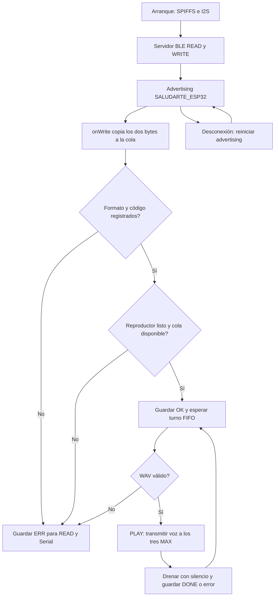

# SALUDARTE — Firmware para SaludarteApp

Proyecto PlatformIO / Arduino C++ para **ESP32 clásica con 4 MiB de flash**.
Implementa el protocolo Android de códigos de dos dígitos y la **opción B:
tres MAX98357A por I2S**, conforme a las conexiones del proyecto.

**Los códigos BLE no contienen audio.** Para oír las voces en los parlantes,
colocar sus WAV en `data/audio/` y cargarlos a SPIFFS. Que las voces estén dentro
de SaludarteApp no las hace accesibles a la ESP32: esta versión no implementa
transferencia de archivos desde Android ni streaming de audio por BLE.

## Organización del código

| Archivo | Función |
|---|---|
| `src/main.cpp` | Inicialización, validación del código y estados |
| `src/BleTransport.cpp` | Servidor, callbacks onWrite/onRead y reconexión |
| `src/AudioPlayer.cpp` | Función `play()`, tarea I2S y cola de audios |
| `include/Activities.def` | Tabla de códigos, enum, actividades y archivos |
| `include/Config.h` | Pines, volumen, UUID y parámetros |
| `include/WavReader.h` | Validación RIFF/WAV antes de reproducir |
| `tools/check_assets.py` | Verificación del catálogo y las voces |
| `docs/PRUEBAS_HARDWARE.md` | Pruebas de aceptación en la ESP32 |

La callback BLE copia el mensaje a una cola y retorna. `loop()` valida y busca la
actividad. Una tarea FreeRTOS es la única propietaria del reproductor: envía el
archivo en bloques y atiende hasta ocho pistas pendientes más la actual, en FIFO.
No hay superposición. Los relojes I2S permanecen activos enviando silencio entre
pistas; el WAV mono se duplica en ambos canales para los tres amplificadores.

## BLE y protocolo Android

- Nombre: `SALUDARTE_ESP32`.
- Servicio: `4fafc201-1fb5-459e-8fcc-c5c9c331914b`.
- Característica: `beb5483e-36e1-4688-b7f5-ea07361b26a8`.
- Propiedades: **READ | WRITE**, sin NOTIFY ni descriptor de suscripción CCCD.
- Un cliente a la vez. No se exige emparejamiento/autorización en esta versión.

Android debe enviar exactamente **dos caracteres ASCII**, mediante WRITE con
respuesta. Por ejemplo, `"01".toByteArray(Charsets.UTF_8)` contiene los bytes
`0x30, 0x31`. No enviar un entero binario, JSON, comillas, espacios, saltos de línea
ni terminador NUL. Los nombres como `DESPERTAR` ya no son comandos válidos.

| Código | Actividad | Archivo local | Ruta ESP32 |
|---|---|---|---|
| `01` | Despertar | `data/audio/0001.wav` | `/audio/0001.wav` |
| `02` | Desayunar | `data/audio/0002.wav` | `/audio/0002.wav` |
| `03` | Bañarse | `data/audio/0003.wav` | `/audio/0003.wav` |
| `04` | Caminata | `data/audio/0004.wav` | `/audio/0004.wav` |
| `05` | Merendar | `data/audio/0005.wav` | `/audio/0005.wav` |
| `06` | Almorzar | `data/audio/0006.wav` | `/audio/0006.wav` |
| `07` | Cenar | `data/audio/0007.wav` | `/audio/0007.wav` |
| `08` | Taller | `data/audio/0008.wav` | `/audio/0008.wav` |
| `09` | Dormir | `data/audio/0009.wav` | `/audio/0009.wav` |
| `10` | Medicamento | `data/audio/0010.wav` | `/audio/0010.wav` |
| `11` | Cepillarse | `data/audio/0011.wav` | `/audio/0011.wav` |
| `12` | Descanso | `data/audio/0012.wav` | `/audio/0012.wav` |
| `99` | Alerta de emergencia | `data/audio/0099.wav` | `/audio/0099.wav` |
| `V0`–`V9` | Volumen de 0 % a 100 % | — | Ajusta el volumen sin detener el audio |

Los comandos de volumen también son exactamente dos bytes ASCII. Los pasos se
convierten linealmente a porcentaje entero: `V0=0`, `V1=11`, `V2=22`, `V3=33`,
`V4=44`, `V5=55`, `V6=66`, `V7=77`, `V8=88` y `V9=100`. Durante una voz nueva
el nivel actualizado se aplica en el siguiente bloque I2S; no hace falta volver
a iniciar la pista. READ confirma, por ejemplo, `OK:V5:55`. Al reiniciar, el
volumen vuelve al valor inicial `Config::VOLUME_PERCENT`.

**Migración:** cambiaron nombre, UUID, comandos y varias asociaciones de audio.
Revisar el contenido de los archivos 0005–0012 si se reutilizan grabaciones de la
versión anterior. Actualizar la aplicación para usar el nuevo servicio y volver
a descubrir sus características tras cargar este firmware.

Al desconectarse, ESP32 reinicia advertising automáticamente, con reintento si
falla. La app debe volver a conectar y descubrir el servicio. El nombre completo
se publica en scan response; escanear por UUID con escaneo activo. La ejecución
aceptada continúa aunque se pierda BLE. Reiniciar la placa elimina las colas.

### Respuestas mediante READ

READ devuelve el último estado procesado, también registrado por Serial:

| Respuesta de ejemplo | Significado |
|---|---|
| `READY` | Reproductor inicializado; no verifica que existan todas las voces |
| `OK:02` | Solicitud de Desayunar aceptada en la cola |
| `OK:V5:55` | Volumen aceptado y ajustado a 55 % |
| `PLAY:02` | WAV validado y comenzó el streaming I2S |
| `DONE:02` | Última muestra transmitida, DMA drenado con silencio |
| `ERR:FORMAT` | Longitud distinta de 2 o comando de volumen con sufijo no numérico |
| `ERR:UNKNOWN` | Dos dígitos, pero código no registrado (por ejemplo `13`) |
| `ERR:INPUT_QUEUE` | Cola de entrada saturada; comandos descartados |
| `ERR:PLAYER` | Fallo de inicialización, por ejemplo SPIFFS sin imagen |
| `ERR:PLAYER:02` | Solicitud rechazada porque el reproductor no inició |
| `ERR:QUEUE:02` | Cola de audio llena; solicitud rechazada |
| `ERR:FILE:02` | WAV ausente o no se puede abrir |
| `ERR:WAV:02` | Formato no compatible o archivo dañado |
| `ERR:READ:02` | Error al leer el audio durante reproducción |
| `ERR:I2S:02` | Error de transmisión; reiniciar para recuperar la salida |

La respuesta ATT de WRITE confirma la escritura, no la reproducción. READ es una
instantánea: puede mostrar el estado previo si se consulta antes de que `loop()`
procese el comando y puede omitir estados breves como OK/PLAY. La app puede hacer
lecturas periódicas, serializando las operaciones GATT. No existe historial,
notificación, ID de solicitud ni deduplicación: dos escrituras de `02` reproducen
dos veces. No retransmitir automáticamente tras una desconexión con resultado
incierto. Para seguimiento inequívoco de múltiples solicitudes sería necesario
ampliar el protocolo Android/firmware con IDs y confirmaciones.

`99` reproduce el audio de emergencia en FIFO. No interrumpe la pista actual y
no realiza llamadas ni alertas externas. `DONE` confirma transmisión digital;
no detecta parlantes desconectados ni confirma que alguien escuchó el mensaje.

## Conexiones de los tres MAX98357A

| ESP32 / alimentación | Destino |
|---|---|
| GPIO26 | BCLK de los tres MAX |
| GPIO25 | LRC / WS de los tres MAX |
| GPIO22 | DIN de los tres MAX |
| +5V_SYS | VIN de cada MAX, en ramales desde la fuente |
| +5V_SYS → JP1 | 5V/VIN de la placa ESP32 |
| GND común | GND de ESP32 y de los tres MAX |
| MAX1 OUT+ / OUT− | + / − del parlante 1 |
| MAX2 OUT+ / OUT− | + / − del parlante 2 |
| MAX3 OUT+ / OUT− | + / − del parlante 3 |

Cada amplificador recibe la misma voz. No se necesita MCLK. El firmware configura
I2S estándar a 16000 Hz, estéreo, con slots de 32 bits y BCLK de 1,024 MHz, igual
que la prueba independiente de pitido. Los WAV se almacenan a 8000 Hz; el
reproductor duplica cada muestra al transmitir para mantener duración y tono.
GPIO entrega lógica de 3,3 V. Asegurar SD/EN habilitado según el breakout. Como
L y R son iguales, cualquier selección de canal reproduce el mensaje. Mantener
cables cortos y desacoplo local.

**OUT− no va a GND**: es una salida diferencial. No unir salidas de amplificadores
entre sí. Alimentar los MAX desde +5V_SYS, sin llevar su corriente a través de la
placa ESP32 ni del regulador 3V3. Dimensionar fuente y parlantes según impedancia,
potencia y volumen. Revisar la protección USB/VIN antes de alimentar simultáneamente
por USB y JP1. Véase la [hoja de datos MAX98357A](https://www.analog.com/media/en/technical-documentation/data-sheets/MAX98357A-MAX98357B.pdf).

## Librerías y carga con PlatformIO

`platformio.ini` fija `espressif32@6.12.0` (Arduino-ESP32 2.0.17) y
`h2zero/NimBLE-Arduino@2.3.6`. SPIFFS, FreeRTOS y `driver/i2s.h` vienen con Arduino.
No instalar DFPlayer. Este código usa el driver I2S de ESP-IDF 4.4: no mezclarlo
con ejemplos Arduino 3.x sin migrar `AudioPlayer.cpp`.

Conectar por USB y ejecutar desde la raíz del proyecto en PowerShell:

```powershell
$env:PLATFORMIO_CORE_DIR = Join-Path (Get-Location) '.pio-core'
$pio = 'C:\Users\User\.platformio\penv\Scripts\pio.exe'
& $pio run
& $pio run --target upload
```

Los originales PCM16 se conservan en `assets/audio_source/`. Para preparar las
voces compactas y cargar firmware y SPIFFS:

```powershell
& 'C:\Users\User\.platformio\penv\Scripts\python.exe' tools/prepare_audio.py
if ($LASTEXITCODE -ne 0) { throw 'No se pudieron preparar los WAV' }
& 'C:\Users\User\.platformio\penv\Scripts\python.exe' tools/check_assets.py
if ($LASTEXITCODE -ne 0) { throw 'Los WAV no caben o no son válidos' }
& $pio run
if ($LASTEXITCODE -ne 0) { throw 'Falló la compilación' }
# Primero se carga el firmware, que actualiza la tabla de particiones.
& $pio run --target upload
if ($LASTEXITCODE -ne 0) { throw 'Falló la carga del firmware' }
# Después se carga SPIFFS usando el nuevo offset y tamaño.
& $pio run --target uploadfs
if ($LASTEXITCODE -ne 0) { throw 'Falló la carga de SPIFFS' }
& $pio device monitor --baud 115200
```

Cargar SPIFFS solo después de que el verificador termine sin errores. Mantiene un
presupuesto conservador del 65 % de la partición porque el generador de SPIFFS
puede imprimir `SUCCESS` aunque haya fallado al agregar archivos. `uploadfs`
reemplaza la imagen completa: incluir todos los audios que se quieran conservar.
El firmware no formatea SPIFFS automáticamente. `upload` y `uploadfs` son operaciones distintas.
Para escoger el puerto usar `& $pio device list` y añadir `--upload-port COM5`
a la orden de carga, sustituyendo COM5 por el puerto real. Si queda en Connecting,
mantener BOOT durante el inicio de la conexión. Reiniciar tras la carga.

La ruta de compilación comprobada es PlatformIO; no hace falta un sketch `.ino`.
La placa configurada es ESP32 clásica/4 MiB: para otra variante hay que revisar
board, particiones y pines. `partitions.csv` reserva 0xF0000 bytes para la
aplicación y 0x300000 bytes para SPIFFS, sin OTA. `Config.h` declara los mismos
offsets/tamaños y `tools/check_assets.py` verifica que no se desincronicen.

## Archivos de audio

Formato del archivo cargado a SPIFFS: **WAV RIFF, PCM mono sin signo de 8 bits,
8000 Hz**. El lector también acepta PCM16 mono a 8000 Hz si se reemplaza una voz
individual y cabe en SPIFFS. Se rechazan MP3, estéreo, otra frecuencia, archivos
vacíos o truncados. Los maestros guardados en `assets/audio_source/` son PCM16.
Si se añade una voz, conviértela primero a PCM16 mono a 8000 Hz; renombrar un MP3
a WAV no convierte su contenido. Ejemplo con FFmpeg:

```powershell
ffmpeg -i voz_desayunar.mp3 -ac 1 -ar 8000 -c:a pcm_s16le assets/audio_source/0002.wav
& 'C:\Users\User\.platformio\penv\Scripts\python.exe' tools/prepare_audio.py
```

El sistema de 8 bits reduce a la mitad el espacio de las voces PCM16 sin cambiar
su frecuencia ni su duración; la cuantización es adecuada para mensajes hablados.
No sobrescribas `assets/audio_source/` con audio temporal. Para probar únicamente
la salida I2S sin reemplazar grabaciones:

```powershell
& 'C:\Users\User\.platformio\penv\Scripts\python.exe' tools/make_test_tone.py data/audio/0001.wav
& $pio run --target uploadfs
```

El generador no sobrescribe archivos; el tono no es una voz. Para restaurar el
catálogo después de usar un tono, vuelve a ejecutar `tools/prepare_audio.py` y
carga de nuevo SPIFFS. El almacenamiento compacto usa 8000 bytes/segundo; la
partición admite las 13 voces con el margen indicado. Volumen inicial: 35 %
digital, ajustable en `Config.h`; verificar el nivel acústico en el circuito real.

## Agregar una actividad

Añadir una fila a `include/Activities.def`:

```cpp
ACTIVIDAD(LEER, "13", 13, "/audio/0013.wav")
```

Esto genera el enum y la entrada de búsqueda. Usar dos dígitos ASCII, ID decimal
correspondiente y único entre 1 y 99, ruta única de hasta 31 caracteres. Copiar el
WAV, validar catálogo, actualizar firmware y SPIFFS. El botón Android enviará `13`.
No cambiar la lógica BLE ni la reproducción. Agregar solo el botón no registra
el comando ni transfiere su audio; no hay aprovisionamiento dinámico en esta versión.

## Flujo



## Verificación

- Firmware compilado para `esp32dev`; no cargado automáticamente a la placa.
- Diez pruebas Python del catálogo y herramientas WAV:
  `python -m unittest discover -s tests -v`.
- Las pruebas Python no ejecutan BLE, I2S ni el lector C++ sobre hardware.
  Completar `docs/PRUEBAS_HARDWARE.md` con los parlantes y SaludarteApp.

Referencias: [driver I2S Espressif 4.4.7](https://docs.espressif.com/projects/esp-idf/en/v4.4.7/esp32/api-reference/peripherals/i2s.html),
[callbacks NimBLE 2.3.6](https://github.com/h2zero/NimBLE-Arduino/blob/2.3.6/examples/NimBLE_Server/NimBLE_Server.ino).
